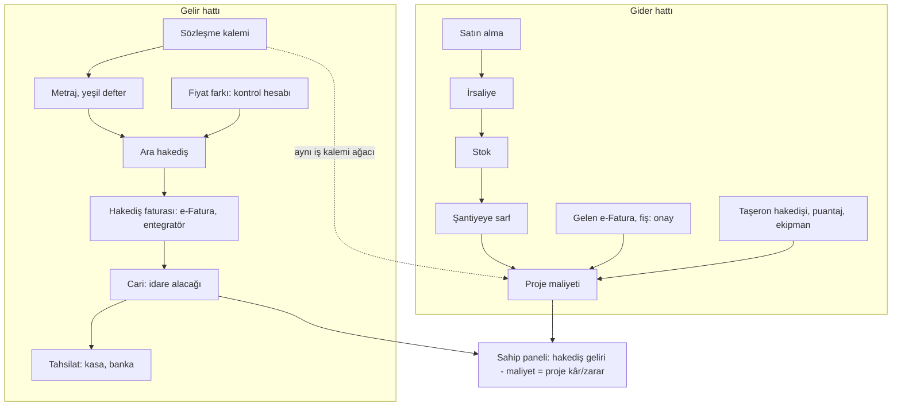
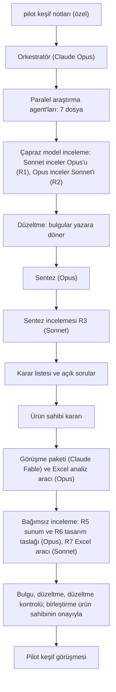

# İnşaat ERP — Proje Vitrini

> Türkiye'de kamu yapım işleri yapan yüklenici firmalar için bir ERP ürünü: proje, hakediş, maliyet ve e-belge süreçlerini tek çatıda toplayan, bulut tabanlı, tarayıcıdan erişilen ve ürünleşmeye hazır (çok kiracılı) bir sistem için araştırma, mimari düşünce ve yol haritası. Gereksinim keşfi bir pilot firmayla yürütülüyor.

**Durum: Aşama 0 — araştırma, bağımsız incelemesi ve pilot keşif görüşmesi hazırlığı tamamlandı (2026-11-18). ERP'nin kendisi için henüz kod yok; yardımcı bir Excel analiz aracı geliştirildi (kaynak kod özel). Sırada: pilot firmayla keşif görüşmesi; ardından Excel analiz aracının gerçek dosyalarla denenmesi.**

**Kısaca:**

- **Neden bu proje:** Gerçek ihtiyaçları olan bir inşaat firması için bu sistemi geliştiriyorum ve aynı ihtiyacı olan başka firmalara da uyarlayıp sunabilecek bir ürün olarak tasarladım. Pilot firmayla yürütülen gerçek gereksinim keşfi, segment geneline uyarlanabilir bir ürüne dönüştürülüyor; bu yüzden çıkan işler yeniden kullanılabilir varlıklar olarak kuruldu: çok kiracılı mimari hedefi, Excel'den geçiş yöntemi ve aracı, hakediş/poz alan bilgisi.
- **Dürüst durum:** ERP henüz geliştirilmedi. Şimdiye kadar tamamlanan somut işler: araştırma ve bağımsız incelemesi, bir görüşme paketi ve 78 testli bir Excel analiz aracı.
- **Ne yaptım:** Ürün sahibi olarak projenin kapsam çerçevesini ve kararlarını yönettim; araştırmayı Claude Opus orkestratör ve işe göre model seçilen araştırma agent'larıyla yürüttüm (ayrıntı: [Yapay zekâ destekli süreç](#yapay-zekâ-destekli-süreç)).
- **Ne çıktı:** 7 konu bazlı araştırma, 3 çapraz model inceleme (13 belgede 77 bulgu; biri önerilen bir Excel aracındaki kritik güvenlik açığı, araç elendi), modül haritası, yol haritası, teknik alternatifler ve risk listesi. Sonrasında: bir **görüşme paketi** (15 slaytlık sunum, 5 ekranlık tıklanabilir tasarım taslağı, soru listesi, Excel paylaşım rehberi) ve kendi yazdığımız, yalnızca statik analiz yapan bir **Excel analiz aracı**; ikisi de ayrı bir modelin incelemesinden geçti (R5–R7).
- **Teknik yaklaşım kararı:** kendi yazılımımız; hazır açık kaynak ERP (Odoo vb.) temeli kullanılmaz. Gerekçeler ve yeniden değerlendirme koşulu: [Teknik yaklaşım](#teknik-yaklaşım).
- **Sırada:** pilot firmayla keşif görüşmesi, Excel analiz aracının gerçek dosyalarla denenmesi, kapsam kararı; yığın ve barındırma kararı.

> **Bu bir vitrin (showcase) reposudur.** ERP yazılımının kendisi için henüz kod yoktur; yardımcı Excel analiz aracının kaynak kodu ise özeldir (mülakatta gösterilebilir). Depo, araştırma bulgularını, mimari düşünceyi, yol haritasını, görüşme paketinin ve aracın tasarımını ve yapay zekâ destekli çalışma sürecini gösterir. Pilot firmanın adı ve pilot firmaya ait belgeler (keşif notları, görüşme soru listesi, karar kaydının kendisi) gizlilik nedeniyle yayımlanmaz; pilot firma anılmaz, kararların kısa karşılıkları [özet belgesindedir](docs/ARASTIRMA-OZETI.md#karar-numaraları). Vitrin, proje ilerledikçe güncellenir.

**English summary:**

- **Why:** I am building this system for a construction firm with real needs, and I have designed it as a product that can be adapted and offered to other firms with the same needs. Real requirements discovery with a pilot firm is turned into a product for the whole segment; the reusable assets are the multi-tenant architecture goal, the Excel migration method and tool, and the progress-payment (hakediş) / unit-price domain knowledge. **Honest status: the ERP itself has not been built yet;** completed so far are the research and its independent review, a meeting package and an Excel analysis tool (78 tests).
- **What:** "İnşaat ERP" is a planned cloud-based, browser-accessed, multi-tenant-ready ERP for contractors that carry out public construction works in Turkey (a segment where many firms run their processes on Excel — an assumption); requirements discovery is run with a pilot firm. It covers contract items, quantity measurements, progress payments (hakediş), e-invoicing, accounts, purchasing, stock and project costing in one system.
- **Status:** Phase 0 — research, its independent review and preparation for the discovery meeting with a pilot firm were completed on 2026-11-18. **There is no code for the ERP itself yet;** a helper Excel analysis tool has been built (source code is private). Next: the discovery meeting with the pilot firm, then trying the Excel tool on real files.
- **Technical decision:** build our own software; no off-the-shelf open-source ERP base (Odoo etc.), because of a simple UI, freedom for productization and licensing, and because the construction-specific core would have to be written in any case. Reconsidered only if a pilot or customer firm wants the statutory ledger and e-Ledger inside the ERP. Stack and hosting are still open.
- **Meeting package:** a 15-slide deck, a 5-screen clickable design draft (fictional data), a printable question list and an Excel-sharing guide, designed by one model and reviewed by another. The review caught real domain errors (see [docs/GORUSME-PAKETI.md](docs/GORUSME-PAKETI.md)).
- **Excel analysis tool:** a static-analysis-only tool (no formula evaluation, no macro execution, no network code) that inventories sheets, formulas, macros and data quality, and has a share mode with placeholders; 78 automated tests; an independent review with its own adversarial files closed several leaks (see [docs/EXCEL-ANALIZ-ARACI.md](docs/EXCEL-ANALIZ-ARACI.md)).
- **How:** an AI-orchestrated workflow with a human product owner: a Claude Opus orchestrator and parallel research agents chosen per task (Opus for legislation, unit prices and architecture; Sonnet for sector, reference ERPs, document automation and Excel migration), with **cross-model review** (Sonnet reviews what Opus wrote and vice versa; all three models used (Claude Fable, Opus, Sonnet) are Claude models, so independence is limited), a review of the synthesis, and corrections sent back to the authors.
- **Result:** 7 research documents and 3 reviews with 77 findings across 13 documents, including a critical vulnerability in a recommended Excel-analysis library that led to its removal.
- **Showcase:** this repository contains research, architecture thinking, risks, a roadmap, descriptions of the meeting package and the tool, and the process description, but no ERP software, no tool source code and no documents of the pilot firm. See [docs/GELISTIRME-SURECI.md](docs/GELISTIRME-SURECI.md).

**Öne çıkan belgeler:**

| Belge | Neden okunmalı |
|---|---|
| [Excel geçiş planı](docs/arastirma/07-excel-gecis-plani.md) | Belgelenmemiş Excel formüllerini iş kuralı kartlarına çeviren, doğrulama katmanlı ve güvenlik kurallı bir geçiş yöntemi |
| [Teknik alternatifler](docs/TEKNIK-ALTERNATIFLER.md) | Odoo, Frappe ve sıfırdan geliştirmenin artı/eksilerle karşılaştırması; "kendi yazılımımız" kararı, gerekçeleri ve yeniden değerlendirme koşulu |
| [Excel analiz aracı](docs/EXCEL-ANALIZ-ARACI.md) | Güvenilmeyen Excel dosyalarını çalıştırmadan analiz eden araç: güvenlik tasarımı, paylaşım kipi ve bağımsız incelemenin bulduğu sızıntılar |
| [Görüşme paketi](docs/GORUSME-PAKETI.md) | Pilot keşif görüşmesi için sunum ve tıklanabilir tasarım taslağı; ayrı bir modelin incelemesinin yakaladığı somut alan hataları |
| [R2 incelemesi](docs/arastirma/inceleme/R2-01-04-05-07.md) | Çapraz model incelemenin somut çıktısı: kritik güvenlik açığı, çözülen sahte çelişkiler, doğrulama notları |

---

## İçindekiler

- [Problem ve yaklaşım](#problem-ve-yaklaşım)
- [Öne çıkan araştırma bulguları](#öne-çıkan-araştırma-bulguları)
- [Modül haritası](#modül-haritası)
- [Yol haritası](#yol-haritası)
- [Teknik yaklaşım](#teknik-yaklaşım)
- [Görüşme paketi](#görüşme-paketi)
- [Excel analiz aracı](#excel-analiz-aracı)
- [Yapay zekâ destekli süreç](#yapay-zekâ-destekli-süreç)
- [Bu depoda neler var?](#bu-depoda-neler-var)
- [Geliştirici](#geliştirici)
- [Lisans](#lisans)

## Problem ve yaklaşım

**Pilot firmadan ürüne.** Proje, gerçek ihtiyaçları olan bir pilot firmayla yürütülen gereksinim keşfiyle başladı; ama sistem tek firmaya göre değil, aynı ihtiyacı olan başka yüklenici firmalara da uyarlanıp sunulabilecek bir ürün olarak tasarlanıyor. Bunu mümkün kılan, firmaya özgü olmayan ve yeniden kullanılabilir üç varlık var: (1) tek müşteriyle başlayıp ilk günden çok kiracılı kurulan mimari hedefi, (2) Excel'den geçiş yöntemi ve bunu destekleyen Excel analiz aracı, (3) hakediş, poz ve mevzuat alan bilgisi. ERP'nin kendisi henüz geliştirilmedi; bu bölüm bir tasarım hedefidir, tamamlanmış bir ürün değil.

Hedef segment, kamu ihaleleriyle yapım işi yürüten yüklenici firmalardır; bu segmentteki firmaların önemli bir kısmı operasyonunu Excel dosyaları ve bu dosyalardaki hesaplamalar üzerinden yürütür *(varsayım, pilot keşifte doğrulanacak)*. Aşağıdaki "problem" satırları pilot keşifte ifade edilen ihtiyaçlar, araştırmanın çıkardığı sonuçlar ve henüz doğrulanmamış varsayımların birleşimidir; varsayım olanlar *(varsayım, pilot keşifte doğrulanacak)* diye işaretlidir. Belgelerde her madde **[GEREKSİNİM] / [ÖNERİ] / [BELİRSİZ]** etiketiyle ayrılır (**[GEREKSİNİM]**: pilot keşifte ifade edilen ihtiyaç).

| Problem | Bu projenin yaklaşımı |
|---|---|
| Proje, hakediş ve maliyet ayrı Excel dosyalarında; gelir ile maliyet kopuk olabilir *(varsayım, pilot keşifte doğrulanacak)* | Sözleşme kalemi, metraj, hakediş ve gider tek iş kalemi ağacında buluşur; "bu ay hakedişle alınan ve harcanan" tek ekranda görünür |
| Hakediş hesapları ve kesintiler Excel formüllerinde; formülün yalnızca birkaç kişide olması riski *(varsayım, pilot keşifte doğrulanacak)* | Her hesap önce yazıya dökülüp müşteriye onaylatılır (iş kuralı kartı); Excel ile paralel çalışma ve mutabakat olmadan geçiş yapılmaz |
| Mevzuata bağlı oranlar ve süreler sık değişir, sözleşmeye göre farklı kurallar uygulanır | Oran ve süreler tarih aralıklı parametre olarak tutulur; sözleşmede "ihale ilan tarihi, kural sürümü" ilişkisi bulunur |
| Faturalar, fişler ve belgeler elle işleniyor olabilir; pilot keşifte otomatik işleme ihtiyacı ifade edildi *(belge dağılımı bilinmiyor, doğrulanacak)* | Önce e-Fatura XML ve hızlı elle giriş; PDF/fotoğraf okuma pilot ölçümden sonra; her aşamada insan onayı ve denetim izi |
| Resmî birim fiyat verisinin yazılımda kullanımı Bakanlığın erişim beyanıyla kısıtlı; hukuki durumu belirsiz | İlk sürümde yalnızca firmanın kendi sözleşme kalemleri; resmî katalog hukuk ve lisans kararına bağlı |
| 5–10 yıl sonra da okunabilir, yedekli ve güvenli veri | Açık biçimli yıllık arşiv, yedek ve geri yükleme testi, rol × proje yetkisi, denetim kaydı (öneri aşamasında) |

## Öne çıkan araştırma bulguları

Aşağıdaki bulgular, [yönetici özetindeki](docs/ARASTIRMA-OZETI.md) 12 bulgudan seçilmiştir. Doğrulama durumu her maddede belirtilmiştir; **bunlar hukuki ya da mali müşavirlik görüşü değildir.**

1. **Resmî birim fiyatların yazılımda kullanımı kısıtlı.** Birim fiyatları yayımlayan kurulun erişim beyanı, içeriğin yazılıma, dijital platforma veya veri tabanına aktarılmasını yazılı izin olmadan yasaklıyor (FSEK'e atıfla; resmî sayfadan doğrulandı). Resmî bir API ya da XML yayını **bulunamadı** (yokluğu kesin doğrulanmadı). Sonuç: ilk sürümde toplu poz aktarımı yok, yalnızca firmanın sözleşme kalemleri; hukuk görüşü ve lisans seçeneği ayrı karar. Ayrıntı: [02 §2](docs/arastirma/02-poz-birim-fiyat-hakedis.md), [Riskler R1](docs/RISKLER.md).
2. **Hakediş ve fiyat farkı kuralları ihale ilan tarihine göre sürümlenmeli.** 30.07.2025 tarihli değişiklikler yalnızca 01.09.2025 ve sonrasında ilan edilen ihalelere uygulanıyor (ikincil kaynak; bağımsız incelemede teyit edildi). Fiyat farkı formülü deterministik, ama endeks serisi ve baz yılı değişiklikleri (2026'da TÜFE 2025=100) hata kaynağı; ilk sürümde elle endeksli "kontrol hesabı" öneriliyor. Temel endeks yorumu ve bir geçiş kuralı **doğrulanmadı**. Ayrıntı: [02 §4–5](docs/arastirma/02-poz-birim-fiyat-hakedis.md).
3. **e-Belge zorunlulukları ve özel entegratör yaklaşımı.** e-Fatura büyük olasılıkla zorunlu (inşa için 500 bin TL, genel 3 milyon TL eşiği; ikincil kaynaktan teyit, "inşa" ibaresinin yükleniciyi kapsaması yorum, mali müşavir teyidi gerekir); bilanço esasında e-Defter 2025'ten beri zorunlu (ikincil). Gelir İdaresi'nin listesinde 95 özel entegratör var (resmî kaynakla doğrulandı); doğrudan entegrasyon küçük bir firma için uygun görünmüyor, bu yüzden entegratör API'si ve soyutlama katmanı öneriliyor **[BELİRSİZ]**. Ayrıntı: [03 §1–2](docs/arastirma/03-muhasebe-ebelge-mevzuat.md).
4. **Belge otomasyonunda önce e-belge XML, Türkçe OCR desteği sınırlı.** e-Fatura XML'i OCR'sız okunur; Google ve AWS fatura ayrıştırıcıları resmî belgeye göre Türkçeyi desteklemiyor, Azure destekliyor (doğrulandı). Türkçe fiş başarımı için kaynaklı veri bulunamadı; bu yüzden PDF/fotoğraf okuma pilot ölçümden sonraya bırakıldı, insan onayı zorunlu ve bu yöntem pilot keşifte teyit edilmedi **[BELİRSİZ]**. Ayrıntı: [05](docs/arastirma/05-belge-otomasyonu.md).
5. **Açık kaynak ERP temeli ile sıfırdan geliştirme karşılaştırması.** Odoo'nun e-Fatura, e-Arşiv ve e-İrsaliye modülleri Community sürümde ve LGPL-3 (kaynak koddan doğrulandı) ama ücretli bir entegratör hesabı gerektiriyor; e-Defter için Enterprise gerekip gerekmediği **doğrulanmadı**. Hakediş ve poz mantığı her seçenekte özel geliştirme ister. Karşılaştırma değerlendirmeye dayanır, ölçülmemiştir; ürün sahibi sonuçta hazır ERP temelini kullanmamaya karar verdi ([Teknik yaklaşım](#teknik-yaklaşım)). Ayrıntı: [04 §3](docs/arastirma/04-referans-erp-karsilastirma.md), [Teknik alternatifler](docs/TEKNIK-ALTERNATIFLER.md).
6. **Veri konumu ve KVKK.** e-belgelerin asıl muhafazası Türkiye'de olmalı; AB'de barındırma KVKK'ya göre yurt dışı aktarımdır (standart sözleşme ve 5 iş günü içinde bildirim; doğrulandı). AWS'nin İstanbul Local Zone'unda yönetilen veritabanı (RDS) yok. İki araştırma farklı yönde öneri verdi; karar müşteriye ve hukuk teyidine bağlı. Ayrıntı: [06 §4](docs/arastirma/06-teknik-mimari-altyapi.md), [03 §6](docs/arastirma/03-muhasebe-ebelge-mevzuat.md).
7. **Excel geçişinde en büyük risk bilgisel, teknik değil.** Belgelenmemiş formül bilgisi için iş kuralı kartları, üç katmanlı doğrulama ve mutabakat önerildi; müşteri dosyaları güvenilmez sayılıp yalıtılmış ortamda işlenir. Bir araç, kritik güvenlik açığı nedeniyle (CVE-2024-53924) listeden çıkarıldı; yerine formül hesaplamayan, yalnızca statik analiz yapan kendi aracımız geliştirildi ([Excel analiz aracı](#excel-analiz-aracı)). Ayrıntı: [07](docs/arastirma/07-excel-gecis-plani.md).
8. **Sektör: sözleşme kalemi ağacı omurga; teminat takibi boş alan olabilir.** Sınırlı taramaya göre yerli ürün tanıtımlarında teminat mektubu takibi görünmüyor; bunun gerçek bir acı noktası olduğu müşteriyle doğrulanmalı **[BELİRSİZ]**. Elektronik teminat süreci 2024–2026'da kademeli olarak değişti (kronoloji araştırmada). Ayrıntı: [01](docs/arastirma/01-sektor-moduller.md).

Doğrulanmamış ya da açık kalan başlıca noktalar (Odoo e-Defter, bir fiyat farkı geçiş kuralı, bazı kurumların 2026 birim fiyat listeleri, Türkçe fiş doğruluğu, entegratör gelen-fatura API'leri) [özetin "Doğrulanmış / doğrulanmamış" bölümünde](docs/ARASTIRMA-OZETI.md) listelidir.

## Modül haritası

Aday kapsamdır, onaylı kapsam değildir. Ana veri akışı:



Tam liste (M0–M21), bağımlılıklar ve etiketler: [docs/MODUL-HARITASI.md](docs/MODUL-HARITASI.md). Aşamalara dağılımı:

| Aşama | Ana modüller |
|---|---|
| **1: MVP** | Kimlik, yetki ve çok kiracılı altyapı; proje ve sözleşme (teminat defteri hafif); metraj, poz, ara hakediş, kesintiler; ön muhasebe, cari, kasa/banka; gelen e-Fatura XML, belge deposu, hızlı elle giriş; sahip paneli; Excel içe/dışa aktarım |
| **2** | Satın alma, stok, ekipman, taşeron, puantaj, saha günlüğü, iş programı; fiyat farkı (Excel'de hesaplanıyorsa MVP'ye çekilir); e-Fatura gönderimi (entegratör seçimine bağlı) |
| **3** | PDF/fotoğraf okuma (pilot sonrası), otomatik endeks, kesin hesap, ekipman bakımı, iş deneyim dosyası |
| **4** | Tam resmî muhasebe ve e-Defter (yalnız karar "ERP içinde" ise), resmî poz kataloğu ve teklif (lisans kararına bağlı), ürünleşme |
| Paralel | Kurumsal web sitesi (ERP'den ayrı, küçük bir iş) |

## Yol haritası

Tümü öneridir; süre ve fiyat verilmez. Ayrıntı ve giriş/çıkış kriterleri: [docs/YOL-HARITASI.md](docs/YOL-HARITASI.md).

| Aşama | Konu | Durum |
|---|---|---|
| 0 | Masa başı araştırma: 7 araştırma dosyası, 3 bağımsız inceleme, sentez; görüşme paketi (sunum, tasarım taslağı) ve Excel analiz aracı; ardından karar öncesi adımlar (Excel envanteri, mali müşavir görüşmesi, hukuk görüşü) | ✅ Araştırma, incelemesi, görüşme paketi ve Excel analiz aracı tamamlandı 2026-11-18 · ⏳ Pilot firmayla keşif görüşmesi ve aracın gerçek dosyalarla denenmesi bekliyor (ERP kodu yok) |
| 1 | **MVP: proje maliyeti ve hakediş omurgası** | ⏳ |
| 2 | Operasyon ve e-belge | ⏳ |
| 3 | Otomasyon ve derinlik | ⏳ |
| 4 | Karara bağlı genişlemeler | ⏳ |

**MVP'nin hedefi:** bir projenin hakediş gelirini ve gerçek maliyetini aynı ekranda, Excel'e gerek kalmadan görmek. Seçilen 1–2 aktif projede hakediş ve maliyet takibi Excel'den taşınır; çıkış ölçütü, Excel ile paralel 1–2 tam hakediş/ay kapanışında açıklanamayan fark kalmamasıdır (başlangıç önerisi).

## Teknik yaklaşım

**Karar [ürün sahibi, 2026-11-18]: kendi yazılımımız.** Hazır açık kaynak ERP (Odoo vb.) temeli kullanılmaz; ürün sıfırdan, açık kaynak kütüphanelerle geliştirilir. Karara götüren gerekçeler:

1. **Sade arayüz.** Hedef, tam kontrolü elde tutulan sade bir ekran düzeni; karşılaştırmaya göre hazır bir ERP'nin arayüzünü sadeleştirmek zor.
2. **Ürünleşmeye ve lisansa serbestlik.** Ürünü ileride başka firmalara sunabilmek için lisans koşullarından bağımsız olmak isteniyor (Odoo Community'de kapalı modül konusu hukuki görüş gerektiriyor, Enterprise'ta her müşteri abonelik alır).
3. **İnşaata özgü çekirdek her durumda yazılacak.** Hakediş, poz ve Excel geçişi hiçbir açık kaynak ERP'de hazır gelmiyor; hazır temel kullanılsa bile bu çekirdek özel geliştirme olurdu.

**Yeniden değerlendirme koşulu:** müşteri yasal defter ve e-Defter'in ERP içinde tutulmasında ısrar ederse karar yeniden açılır. O durumda bile ilk tercih, yasal defterin mali müşavirin programında kalması ve ERP'nin ona veri aktarmasıdır.

**Hâlâ açık:** teknoloji yığını (önerilen yön TypeScript + PostgreSQL; para hassasiyeti en üst öncelikse .NET), bulut sağlayıcı ve barındırma, muhasebe kapsamı (K-05) ve veri konumu (K-06). e-Fatura özel entegratör API'siyle, resmî defter mali müşavirde ("Seçenek B") olarak öneriliyor **[ÖNERİ]**. Bu iki yanıt barındırma seçimini en çok değiştirenlerdir.

Karardan önceki karşılaştırma (değerlendirme belge incelemesine dayanır, **ölçülmemiştir**) kayıt için duruyor:

| | Odoo temelli | Frappe temelli | Sıfırdan (TypeScript + PostgreSQL) | Hibrit |
|---|---|---|---|---|
| İlk sürüm hızı | Hızlı | Orta | Yavaş | Orta |
| Sade arayüz | Zor | Orta | Tam kontrol | Yalnız özel kısımda |
| Türkiye muhasebe / e-belge | e-Fatura/e-Arşiv/e-İrsaliye hazır (ücretli entegratör hesabıyla); e-Defter belirsiz | Resmî yerelleştirme yok | Entegratör API'siyle | Hazır sistemde |
| Hakediş / poz | Özel geliştirme | Özel | Özel, tam uyum | Özel |
| Yükseltme yükü | Yüksek | Orta | Düşük | Orta–yüksek |
| Ürünleşme ve lisans | Enterprise'ta her müşteri abonelik alır | MIT | Serbest | İki lisansa bağlı |

Tabloda "sıfırdan" seçeneğinin ilk sürümde yavaş başlaması ve hazır muhasebenin gelmemesi de görünür; bunlar bu yolun bedelidir. Karar sonrası, "Odoo ile sıfırdan aynı mini senaryo" kavram kanıtı gereksiz hâle geldi.

**Çok kiracılı (ürünleşmeye hazır) tasarım hedefi [ÖNERİ]:** tek müşteriyle başlanması, ama veri modelinin ilk günden paylaşılan şema, `tenant_id` ve PostgreSQL satır düzeyi güvenlik (RLS) ile kurulması önerilir; kiracılar arası sızıntı testleri otomatik testlerde zorunlu tutulur ve büyük bir kiracı ileride ayrı veritabanına taşınabilir (D-03). Önerilen güvenlik hedefi OWASP ASVS 5.0 Seviye 2'dir; performans, yedek ve uzun dönem okunabilirlik hedefleri ölçülebilir olarak önerilmiştir. Ayrıntı: [Teknik alternatifler](docs/TEKNIK-ALTERNATIFLER.md), [araştırma 06](docs/arastirma/06-teknik-mimari-altyapi.md). K-xx ve D-xx numaralarının karşılıkları [özet belgesindedir](docs/ARASTIRMA-OZETI.md#karar-numaraları).

## Görüşme paketi

Pilot firmanın yöneticileriyle yapılacak keşif görüşmesi için hazırlanan, **kod içermeyen** dört parçalı pakettir. Ürün kodu değildir; kapsamı taahhüt etmez, görüşmeyi somut bir zemine oturtmak içindir. Metinler ve tasarım dosyaları müşteriye özel olduğu için bu depoda yayımlanmaz; yalnızca yapısı ve nasıl hazırlandığı anlatılır.

| Parça | İçerik |
|---|---|
| Sunum | Firma yöneticilerine yönelik 15 slayt: sorun, çözüm yaklaşımı, gelir ve gider akışı, ilk sürüm kapsamı, Excel dosyalarının paylaşımı |
| Tıklanabilir tasarım taslağı | 5 ekran: sahip paneli, proje özeti, ara hakediş, gelen fatura onayı, Excel içe aktarma. Tüm veriler kurgusaldır (örnek ad ve tutarlar) |
| Görüşme soru listesi | Çıktısı alınabilen A4 soru listesi |
| Excel paylaşım rehberi | Firmanın dosyalarını nasıl ve neyi gizleyerek paylaşabileceğini anlatan kısa rehber |

**Nasıl yapıldı:** sunumu ve tasarım taslağını Claude Fable hazırladı; her biri Opus tarafından bağımsız incelendi (R5 sunum, R6 tasarım taslağı), bulgular yazara döndü, düzeltmeler ayrıca kontrol edildi. İncelemenin yakaladığı somut alan hatası: hakediş ekranında kesin teminat her hakedişten ikinci kez kesiliyordu (çifte teminat; inceleme bunu hata olarak işaretledi, ayrıntı mevzuatla teyit edilecek) ve fiyat farkı satırı eksikti; ekran resmî hakediş özeti sırasına göre düzeltildi ve tüm tutarlar yeniden hesaplandı. Ayrıca müşteriye "söz verildi" izlenimi verebilecek ifadeler netleştirildi; henüz kapsamda olmayan özelliklere "Sonraki aşama" etiketi kondu. Ayrıntı: [docs/GORUSME-PAKETI.md](docs/GORUSME-PAKETI.md).

> Ekran görüntüleri eklenecek ([docs/assets/](docs/assets/) klasörüne).

## Excel analiz aracı

Yüklenici firmaların Excel dosyalarını Excel'de açmadan çözümleyen, yerel çalışan bir araçtır. Amaç: dosyalar geldiğinde hangi sayfaların, formüllerin, makroların ve veri kalitesi sorunlarının olduğunu hızla çıkarmak ve belgelenmemiş hesap kurallarını "iş kuralı kartı" taslağına dökmek ([Excel geçiş planı](docs/arastirma/07-excel-gecis-plani.md) yöntemini otomatikleştirir).

- **Ne yapar:** sayfa (gizli sayfalar dahil) ve adlandırılmış aralık envanteri; formül kalıplarını toplama ve tutarsız formül tespiti; iş kuralı kartı taslağı; makroları yalnız metin olarak çıkarma; veri kalitesi; kişisel verinin değerini değil sayısını ve konumunu raporlama.
- **Paylaşım kipi:** ad ve sabitler yer tutucuyla (`SAYFA_1`, `SABIT_1` gibi) değiştirilir; yer tutucu eşlemesi yalnızca yerelde, paylaşılacak klasörün dışında tutulur.
- **Güvenlik tasarımı:** yalnızca statik analiz (formül değerlendirme ve makro çalıştırma yok), ağ kodu yok, `defusedxml`, zip bombası ve boyut denetimi ayrıştırmadan önce, isteğe bağlı Docker ile ağsız çalıştırma.
- **Doğrulama:** 78 otomatik test (yalnızca sentetik dosyalarla); bağımsız inceleme (Sonnet, R7) kendi hazırladığı saldırgan dosyalarla gerçek sızıntılar buldu, bulunan sızıntılar kapatıldı ve düzeltme kontrolünde yeniden denendi; sonradan kalan küçük bir bulgu (kısaltma sınırında e-posta parçası) yazar tarafından düzeltildi ve regresyon testiyle doğrulandı; 78 testin tamamı geçiyor (orkestratör yeniden çalıştırdı).
- **Bilinen sınırlar:** Docker kurulumu ve gerçek makrolu dosya henüz denenmedi; `.xls` dosyalarında formül okunmaz; gerçek firma dosyasıyla henüz çalıştırılmadı.

Kaynak kod özeldir; mülakatta gösterilebilir. Ayrıntı: [docs/EXCEL-ANALIZ-ARACI.md](docs/EXCEL-ANALIZ-ARACI.md).

## Yapay zekâ destekli süreç



**Kim ne yaptı?**

| | Ürün sahibi (insan) | Yapay zekâ agent'ları |
|---|---|---|
| Yön ve kararlar | Kapsam çerçevesini ve önceliği belirler; ERP için kod yazılmamasına, ürünleşmeye açık mimariye, "kendi yazılımımız" yaklaşımına (hazır ERP temeli yok), görüşme paketinin ve Excel analiz aracının yapılmasına çoktan seçmeli sorularla karar verir (D-01–D-07); bekleyen kararlar ona aittir (K-xx) | Seçenekleri, artı/eksileri ve bir öneriyi sunar; karar vermez |
| Araştırma ve yazım | Pilot firmayla gereksinim keşfini yürütür; sonuçları ve açık noktaları denetler | Claude Opus orkestratör görevleri böler, ortak kuralları yazar, agent'ları paralel çalıştırır ve sentezi yazar. Opus mevzuat, poz/hakediş ve mimari konularını (02, 03, 06); Sonnet sektör, referans ERP, belge otomasyonu ve Excel geçişi konularını (01, 04, 05, 07) araştırdı. Sonraki aşamada görüşme paketinin sunumunu ve tasarım taslağını Claude Fable, Excel analiz aracını Opus yazdı |
| Denetim | Mevzuat konularında uzman (hukuk, mali müşavir) teyidi gerektiğini bilerek hareket eder | Farklı modelle çapraz inceleme: R1 (Sonnet, Opus'un yazdığı 02/03/06'yı), R2 (Opus, Sonnet'in yazdığı 01/04/05/07'yi), R3 (Sonnet, Opus'un sentezini), R5 (Opus, Claude Fable'ın sunumunu), R6 (Opus, Claude Fable'ın tasarım taslağını), R7 (Sonnet, Opus'un Excel aracını) |

Belgelerin yazımı ve incelemesi yapay zekâ agent'larınca yapıldı; insan denetimi ürün sahibine aittir. Bu vitrinin metni de bir Claude Sonnet agent'ı tarafından yazıldı; ilk sürümü ayrı bir Claude Opus incelemesinden (R4) geçti. İlk üç inceleme 13 belgede 77 bulgu çıkardı; bulgular yazara geri gönderildi ve düzeltmeler belgelere işlendi. R3, sentezdeki 28 iddiayı kaynak dosyaya kadar izledi. Görüşme paketi ve Excel aracı için sonradan üç inceleme daha yapıldı (R5–R7); her birinde bulgu, düzeltme ve düzeltme kontrolü döngüsü işletildi, birleştirme ürün sahibinin onayıyla yapıldı. Claude Fable, Opus ve Sonnet'in üçü de Claude modelidir; inceleme yazandan farklı bir modelle yapılır ama bağımsızlık sınırlıdır. Ortak yanılgılar kaçabilir.

İncelemelerin yakaladığı somut örnekler:

- **Güvenlik açığı:** Excel analizi için önerilen bir kütüphanede kritik bir kod çalıştırma açığı (CVE-2024-53924) bulundu; araç listeden çıkarıldı.
- **Sahte çelişki:** elektronik teminat tarihlerindeki "çelişki"nin aslında ardışık adımlar olduğu kaynak metinlerden gösterildi.
- **Lisans çelişkisi:** Odoo e-belge modüllerinin lisans ve sürüm durumuna ilişkin iki belge arasındaki çelişki, modül kaynak kodları okunarak çözüldü.
- **Çifte teminat:** görüşme paketinin hakediş ekranında kesin teminat her hakedişten ikinci kez kesiliyordu ve fiyat farkı satırı eksikti; R6 yakaladı, ekran düzeltilip tutarlar yeniden hesaplandı ([ayrıntı](docs/GORUSME-PAKETI.md)).
- **Kişisel veri sızıntıları:** Excel analiz aracının paylaşım kipinde, R7'nin kendi hazırladığı saldırgan dosyalarla bulduğu sızıntılar (hata mesajında yerel yol, paylaşılacak klasörde eşleme dosyası, kişi adı içeren başlıklar, bazı TCKN/IBAN/telefon biçimleri) kapatıldı ([ayrıntı](docs/EXCEL-ANALIZ-ARACI.md)).
- **Abartılı dil:** sentezde kaynağın söylediğinden daha güçlü yazılmış üç iddia (ör. ikincil kaynakla teyit edilen bir eşiğin "resmî kaynakla doğrulandı" denmesi) geri çekildi.

Etiket disiplini ([GEREKSİNİM]/[ÖNERİ]/[BELİRSİZ]), "doğrulandı / ikincil / doğrulanmadı" kuralı, gizlilik kuralları (müşteri dosyaları repo dışında, dış servislere müşteri adı gönderilmez) ve kararların nasıl alındığı: [docs/GELISTIRME-SURECI.md](docs/GELISTIRME-SURECI.md). Bu sürecin bir verim ya da hız iddiası yoktur; ölçülmemiştir.

## Bu depoda neler var?

```text
insaat-erp-showcase/
├── README.md
└── docs/
    ├── ARASTIRMA-OZETI.md        # Yönetici özeti; belge ve karar numaraları
    ├── MODUL-HARITASI.md         # Modül listesi, veri akışı, bağımlılıklar
    ├── YOL-HARITASI.md           # MVP ve aşamalar
    ├── TEKNIK-ALTERNATIFLER.md   # "Kendi yazılımımız" kararı; Odoo / Frappe / sıfırdan karşılaştırması, barındırma, maliyet bantları
    ├── RISKLER.md                # Risk tablosu (R1–R20)
    ├── GORUSME-PAKETI.md         # Pilot keşif görüşmesi paketi: sunum, tasarım taslağı, soru listesi, rehber (yapı ve süreç)
    ├── EXCEL-ANALIZ-ARACI.md     # Excel analiz aracının tasarımı, güvenlik yaklaşımı ve incelemesi (kaynak kod özel)
    ├── GELISTIRME-SURECI.md      # AI orkestrasyonlu araştırma ve geliştirme süreci
    ├── assets/                   # Ekran görüntüleri için ayrılmış klasör (henüz görsel yok)
    ├── arastirma/                # 01–07: konu bazlı araştırma dosyaları
    │   └── inceleme/             # R1–R3: bağımsız çapraz model incelemeleri (R4–R7 raporları yayımlanmaz)
    └── surec/
        └── ORTAK-KURALLAR.md     # Araştırma agent'larına verilen ortak kurallar
```

Bu depoda **yazılım ve müşteriye ait belgeler bulunmaz**: ERP için henüz kod yoktur, Excel analiz aracının kaynak kodu özeldir; pilot keşif notları, görüşme soru listesi, Excel paylaşım rehberinin metni ve karar kaydının kendisi gizlilik nedeniyle yayımlanmaz.

## Geliştirici

**Kadir Kacır** · [LinkedIn](https://www.linkedin.com/in/kadir-kac%C4%B1r-247412325/)

Ürün sahibi ve proje yöneticisi olarak pilot firmayla gereksinim keşfini yürütüyor, kapsamı ve önceliği belirliyor, kararları veriyor ve araştırmayı yapay zekâ agent'larının orkestrasyonuyla (Claude Opus orkestratör, Opus ve Sonnet araştırma agent'ları, çapraz model inceleme) uçtan uca yürütüyor. Excel analiz aracının kaynak kodu ve süreç belgeleri mülakatlarda istek üzerine gösterilip ayrıntılı anlatılabilir.

## Lisans

**Tüm hakları saklıdır.** Bu depo açık kaynak değildir; yalnızca portföy ve inceleme amacıyla herkese açıktır. İzinsiz kullanım, kopyalama veya dağıtım yapılamaz.
