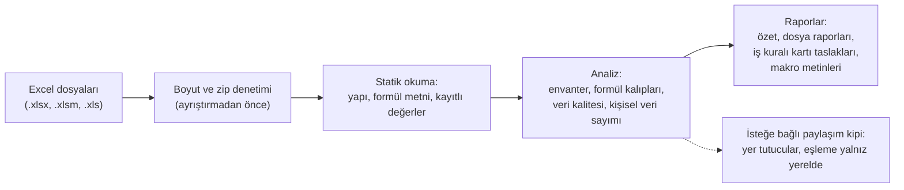

# Excel Analiz Aracı

Yüklenici firmaların Excel dosyalarını Excel'de açmadan çözümleyen, yerel çalışan yardımcı bir araçtır. **Kaynak kodu özeldir** (bu depoda yok); mülakatta gösterilebilir. Bu belge aracın amacını, tasarım ve güvenlik yaklaşımını, nasıl doğrulandığını ve sınırlarını anlatır. Araç ERP'nin kendisi değildir; ERP için henüz kod yoktur.

> Belge numaraları, karar numaraları (K-xx, D-xx) ve "pilot keşif" kavramı için: [ARASTIRMA-OZETI.md](ARASTIRMA-OZETI.md#bu-belgeler-nasıl-okunur).

## İçindekiler

- [Amaç](#amaç)
- [Ne yapar?](#ne-yapar)
- [Paylaşım kipi](#paylaşım-kipi)
- [Güvenlik tasarımı](#güvenlik-tasarımı)
- [Nasıl doğrulandı?](#nasıl-doğrulandı)
- [Bağımsız incelemenin bulduğu sızıntılar](#bağımsız-incelemenin-bulduğu-sızıntılar)
- [Bilinen sınırlar](#bilinen-sınırlar)

## Amaç

Bu segmentteki firmaların operasyonu çoğunlukla Excel dosyalarında yürür *(varsayım)* ve bu dosyalardaki hesapların bir kısmı belgelenmemiş olabilir. [Excel geçiş planı](arastirma/07-excel-gecis-plani.md) bu bilgiyi dört adımda çıkarmayı önerir: envanter, sayfa envanteri, iş kuralı kartı ve veri temizleme. Araç bu adımların elle yapılması gereken kısmını otomatikleştirir; dosyalar geldiğinde şu soruları hızla yanıtlamak için yazıldı: hangi sayfalar var (gizliler dahil), formüller hangi hesap kurallarını uyguluyor, makro var mı, başka dosyalara bağlantı var mı, veride hangi temizlik sorunları var, kişisel veri nerede.

Çıktılar **taslaktır**; boş bırakılan alanlar dosya sahibiyle görüşmede doldurulur. Araç henüz gerçek bir firma dosyasıyla çalıştırılmadı.

## Ne yapar?

- **Envanter:** sayfalar (görünür, gizli, çok gizli), kullanılan aralıklar, birleştirilmiş hücreler, adlandırılmış aralıklar, veri doğrulama listeleri, koşullu biçimler, pivot ve grafikler, dış bağlantılar, sayfalar arası başvurular, hata değerleri.
- **Formül kalıpları:** kopyalanmış formülleri tek bir "desen" altında toplar; aynı sütunda ortak formülden sapan ya da elle sabit yazılmış hücreleri **tutarsız formül** olarak işaretler.
- **İş kuralı kartı taslağı:** her önemli formül deseni için, doldurulmaya hazır bir kart (formülün Türkçe Excel karşılığıyla birlikte) üretilir; kartı dosya sahibiyle doğrulamak sonraki adımdır.
- **Makrolar:** VBA kodu yalnızca **metin olarak** çıkarılır; şüpheli komutlar (dosya açılınca otomatik çalışma, kabuk komutu, internetten indirme gibi) listelenir. Makro hiçbir zaman çalıştırılmaz.
- **Veri kalitesi:** sütun bazında tür karışıklığı, metin olarak yazılmış sayılar, boşluklar, anahtar sütunlarda tekrar, karışık tarih biçimleri, aynı birimin farklı yazılışları (ör. m², m2).
- **Kişisel veri:** TC kimlik no, vergi no, IBAN, telefon, e-posta gibi biçimler için değeri değil, **sayıyı ve hücre konumunu** raporlar. Hücrelerin yanında formül sabitlerine, sayfa adlarına, adlandırılmış aralıklara, yorumlara ve doğrulama listelerine de bakılır.
- **Çıktı:** dosya başına bir özet; biçim olarak Markdown (okumak için) ve JSON (makinece okunur). Aynı girdi her zaman aynı çıktıyı üretir.

## Paylaşım kipi

Normal raporlar müşterinin ticari verisinden parçalar içerir (sayfa ve sütun adları, formüller, makro kodu, dış bağlantı yolları). Bu yüzden raporlar git deposuna girmez ve dışarı verilmez. Raporun bir kısmının başka biriyle (ör. bir danışman ya da inceleyici) paylaşılması gerekirse **paylaşım kipi** kullanılır:

| Konu | Paylaşım kipinde |
|---|---|
| Sayfa, dosya, adlandırılmış aralık ve tablo adları | Yer tutucuya çevrilir (`SAYFA_1`, `DOSYA_1`, `AD_1`, `TABLO_1`) |
| Formüllerdeki sayı ve metin sabitleri | `SABIT_1` gibi yer tutucu |
| Örnek değerler, yorum metinleri, makro kodu | Hiç yazılmaz |
| Sütun başlıkları | Yalnız genel inşaat ve finans terimlerinden oluşanlar (Poz No, Birim Fiyat, Tutar, KDV…) korunur; kişi, firma ya da proje adı olabilecekler `BASLIK_1` olur. Bayrakla tümü korunabilir |
| Korunanlar | Yapı, formül desenleri, fonksiyon adları, başvurular, sayılar |
| Yer tutucu eşlemesi | **Yalnızca yerelde**, paylaşılacak klasörün **dışında** ayrı bir klasöre yazılır; o klasör git'e de girmez |

Kişisel veri maskelemesi **sezgiseldir**: tanınan biçimler `[TCKN]`, `[VKN]`, `[IBAN]`, `[TELEFON]`, `[E-POSTA]` olarak maskelenir; tanınmayan yazımlar, ad-soyad, adres ve maaş gibi bilgiler maskelenmez. Bu yüzden paylaşımdan önce her zaman insan kontrolü gerekir; araç bunu da belgelerinde açıkça söyler.

## Güvenlik tasarımı

Müşteri dosyaları **güvenilmez girdi** sayılır (e-posta ya da mesajla dolaşmış dosyalar olabilir). Tasarım buna göre kurulmuştur:

- **Yalnızca statik analiz.** Formüller hesaplanmaz; yalnızca metin olarak okunur, Excel'in en son kaydettiği değerler olduğu gibi alınır. Formül hesaplayan kütüphaneler bilerek kullanılmaz: araştırmada elenen pycel, güvenilmeyen dosyadaki formül yoluyla kod çalıştırmaya izin veren kritik bir açık (CVE-2024-53924) taşıyordu ([07 §3.1](arastirma/07-excel-gecis-plani.md), [R2](arastirma/inceleme/R2-01-04-05-07.md)).
- **Makro çalıştırma yok.** Makro kodu okunup metin dosyasına yazılır.
- **Ağ kodu yok.** Kodda hiçbir ağ çağrısı yoktur; ayrıca araç çalışırken ağ bağlantısı açılması derinlemesine savunma olarak engellenir. (Bu engel aşılabilir bir savunma katmanıdır; asıl güvence, aracın ağ koduna hiç sahip olmamasıdır.)
- **Güvenli XML ayrıştırma.** `defusedxml` kullanılır; dış varlık (XXE) ve "milyar gülme" (entity bomb) saldırı dosyaları, bağımsız incelemede denendi ve reddedildi.
- **Zip bombası ve boyut denetimi ayrıştırmadan önce.** Dosya boyutu, açılmış toplam boyut, olağan dışı sıkıştırma oranı ve parça sayısı içerik okunmadan kontrol edilir; sınırı aşan dosya açılmaz ve raporda nedeni yazılır.
- **Girdi değiştirilmez.** Dosyalar yalnızca okunur.
- **Yerel yol sızıntısına karşı temizlik.** Hata mesajlarındaki yerel dosya yolları raporlardan temizlenir.
- **İsteğe bağlı Docker ile ağsız çalıştırma.** Konteyner ağsız (`--network none`), girdi salt okunur, kök dosya sistemi salt okunur, tüm yetenekler kapalı, yetkisiz kullanıcı, bellek ve süreç sınırlı çalışır. Bağımlılıklar sürüm sabitlemeli kilit dosyasıyla, taban imaj özetle (digest) sabitlenir.
- **Python yalıtılmış kipte** (`-I`) çalıştırılır; bulunulan klasördeki dosyalar kod olarak yüklenmez.

## Nasıl doğrulandı?

- **78 otomatik test** (orkestratör yeniden çalıştırdı, tamamı geçiyor; R7 kontrolünde sayı 75'ti, sonraki düzeltmeyle 78 oldu), yalnızca test sırasında üretilen **sentetik** dosyalarla çalışır; depoya gerçek ya da gerçeğe benzer müşteri verisi konmaz.
- Testler, kişisel veri değerlerinin **tüm çıktı dosyalarında** (içerik ile dosya ve klasör adları dahil) aranmasını, aynı girdinin aynı çıktıyı vermesini, makro kodunun yazılmamasını, paylaşım kipinde yer tutucu tutarlılığını ve yabancı klasörün silinmemesini kapsar.
- Ölçek örneği (sentetik): 60 bin satırlık dosya yaklaşık 24–29 saniyede işlendi.
- **Bağımsız inceleme (R7, Sonnet; yazan Opus).** İnceleyici kendi hazırladığı saldırgan dosyalarla (kişi adı başlıkları, çeşitli yazımlarda kimlik ve IBAN numaraları, bozuk dosya, XXE, entity bomb, gerçek dış bağlantı parçası) aracı denedi. Bulgular yazara döndü, düzeltmeler sonrasında inceleyici aynı dosyalarla yeniden denedi (düzeltme kontrolü) ve araç **birleştirilebilir** bulundu; birleştirme ürün sahibinin onayıyla yapıldı. Opus ve Sonnet de Claude modelidir; inceleme yazandan farklı bir modelle yapılır ama bağımsızlık sınırlıdır.

## Bağımsız incelemenin bulduğu sızıntılar

İnceleme 12 bulgu çıkardı (4 orta, 7 düşük, 1 bilgi); en önemlileri paylaşım kipinde gerçek sızıntılardı ve düzeltildi:

| Bulgu | Düzeltme |
|---|---|
| Okunamayan (bozuk) dosyanın hata mesajı **yerel dosya yolunu** (klasör ve kullanıcı adı dahil) paylaşılacak raporlara yazıyordu | Hata mesajından yol temizlendi; bozuk dosya ile paylaşım kipi için test eklendi |
| Yer tutucu eşleme dosyası **paylaşılacak klasörün içine** yazılıyordu; klasör olduğu gibi verilirse özgün adlar da gidecekti | Eşleme paylaşım klasörünün dışındaki yerel bir klasöre yazılıyor |
| Sütun başlıkları aynen korunuyordu; **kişi ve firma adı içeren başlıklar** raporlara geçti | Varsayılan olarak yalnız genel terimler korunuyor, diğerleri yer tutucu oluyor |
| Bazı **kimlik, IBAN ve telefon biçimleri** maskelenmiyordu (boşluklu ya da noktalı kimlik no, tireli ve yabancı IBAN, bazı telefon yazımları, Türkçe karakterli e-posta alanı) | Kalıplar genişletildi; varyantlar testlere eklendi; dokümandaki ifade "yaygın biçimleri maskeler (sezgisel)" olarak yumuşatıldı |
| Kişisel veri **sayımı** yalnız hücre değerlerine bakıyordu; formül sabitindeki ya da sayfa adındaki kimlik numarası sayıma girmiyordu | Formül sabitleri, adlar ve sayfa adları da sayıma dahil edildi |
| Formül örneği kısaltılırken **e-posta parçası** kesim sınırında kalabiliyordu (düzeltme kontrolünde bulundu) | Önce maskeleme, sonra kısaltma; yazar düzeltti, regresyon testiyle doğrulandı (inceleyici bu son düzeltmeyi yeniden denemedi) |

Kalan düşük önemli bulgular (bellek sınırının sıkılaştırılması, çıktı klasörünün git'e girmesine karşı ek koruma, gizli adlı dosyaların atlananlar listesinde gösterilmesi, bağımlılıkların kilitlenmesi, README'deki iki eksik not) da ele alındı.

## Bilinen sınırlar

- **Docker kurulumu henüz denenmedi.** İmaj ve betik yazıldı, ama gerçek bir Docker kurulumunda çalıştırılmadı; ilk çalıştırmada beklenmedik bir hata çıkabilir. Yerel çalıştırma yolu denenmiştir.
- **Gerçek makrolu dosya henüz denenmedi;** makro çıkarma yalnızca sentetik ve sahte çıktıyla test edildi. Gerçek bir firma dosyasıyla da çalıştırılmadı.
- **`.xls` dosyalarında formül okunmaz;** yalnızca yapı ve değerler okunur. `.xlsb`, `.ods`, `.csv` desteklenmez; parola korumalı dosyalar için parolasız kopya gerekir.
- Formüller hesaplanmadığı için, dosya Excel'de son kez hesaplanıp kaydedilmediyse kayıtlı değerler boş ya da eski olabilir.
- `INDIRECT`/`OFFSET` gibi dinamik başvurular statik olarak çözülemez; yalnızca işaretlenir. Excel 4.0 makro sayfaları yalnızca varlık olarak bildirilir.
- Başlık satırı ve anahtar sütun tespiti tahmindir; çok başlıklı tablolarda yanılabilir.
- Kişisel veri maskelemesi sezgiseldir; tanınmayan yazımlar ve ad-soyad, adres, maaş gibi bilgiler maskelenmez. Paylaşım öncesi insan kontrolü gerekir.
- Çok büyük dosyalar bellek ister; sınırı aşan dosyalar varsayılan olarak reddedilir.
- Araç bir yapay zekâ agent'ının yazdığı ve başka bir agent'ın incelediği koddur; güvenlik iddiaları testlere ve incelemeye dayanır, bağımsız bir güvenlik denetimi değildir.
