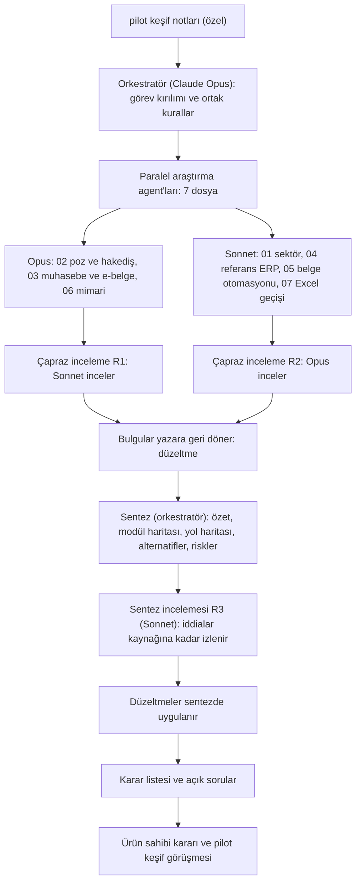
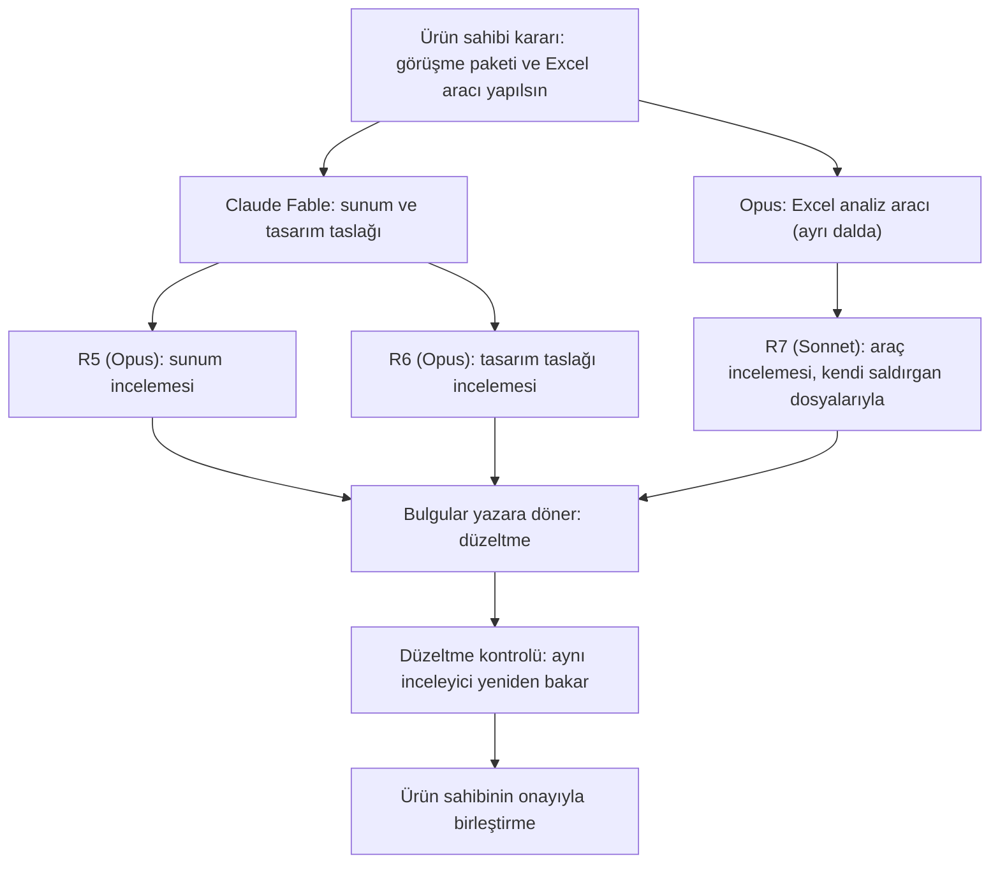

# Geliştirme Süreci: Yapay Zekâ Orkestrasyonlu Araştırma

Bu belge, Aşama 0'daki ilk araştırma turunun ve bağımsız incelemesinin, ardından görüşme paketinin ve Excel analiz aracının nasıl yürütüldüğünü anlatır (pilot firmayla keşif görüşmesi henüz yapılmadı): kim ne yaptı, hangi model hangi işi aldı, işler nasıl denetlendi ve hangi kurallarla çalışıldı. ERP için kod yazılmadı; üretilen şey ağırlıkla belgelerdir, ek olarak bir görüşme paketi ve yardımcı bir Excel analiz aracı (kaynak kodu özel) vardır. Amaç yöntemi göstermek; bir verim ya da hız iddiasında bulunmak **değil**: süreç ölçülmedi ve aşağıda "kaç saatte yapıldı" gibi bir sav yoktur.

> Belge numaraları (00–13), karar numaraları (K-xx, D-xx) ve "pilot keşif" kavramı için: [ARASTIRMA-OZETI.md](ARASTIRMA-OZETI.md#bu-belgeler-nasıl-okunur).

## İçindekiler

- [Akış](#akış)
- [Roller ve model seçimi](#roller-ve-model-seçimi)
- [Görüşme paketi ve Excel aracı (ikinci tur)](#görüşme-paketi-ve-excel-aracı-ikinci-tur)
- [Çapraz model inceleme](#çapraz-model-inceleme)
- [Somut örnekler: incelemelerin yakaladıkları](#somut-örnekler-incelemelerin-yakaladıkları)
- [Etiket disiplini](#etiket-disiplini)
- [Kaynak ve doğrulama durumu kuralı](#kaynak-ve-doğrulama-durumu-kuralı)
- [Gizlilik kuralları](#gizlilik-kuralları)
- [Kararlar nasıl alınır](#kararlar-nasıl-alınır)
- [Sınırlar](#sınırlar)

## Akış

Adımlar:

1. **Pilot keşif ve ortak kurallar.** Orkestratör, pilot keşif notlarını okur ve her agent'ın uyacağı [ortak kuralları](surec/ORTAK-KURALLAR.md) yazar.
2. **Paralel araştırma.** Birbirinden bağımsız yedi konu aynı anda ayrı agent'lara verilir; her agent yalnızca kendi dosyasına yazar.
3. **Çapraz model inceleme.** Her dosyayı, onu yazandan farklı bir model okur ve seçilmiş kritik iddiaları mümkün olduğunca birincil kaynaktan yeniden kontrol eder.
4. **Yazara düzeltme.** Bulgular yazara geri gönderilir; düzeltilen dosya son hâlini alır. İncelemenin çözdüğü çelişkiler belgelere işlenir (ör. [01 Açık noktalar](arastirma/01-sektor-moduller.md), [07 §3.1](arastirma/07-excel-gecis-plani.md)).
5. **Sentez.** Orkestratör düzeltilmiş dosyalardan [özet](ARASTIRMA-OZETI.md), [modül haritası](MODUL-HARITASI.md), [yol haritası](YOL-HARITASI.md), [teknik alternatifler](TEKNIK-ALTERNATIFLER.md) ve [risk listesini](RISKLER.md) çıkarır.
6. **Sentez incelemesi.** Sentez de bağımsız bir incelemeden geçer ([R3](arastirma/inceleme/R3-sentez.md)); sentezdeki her iddia kaynak dosyaya kadar izlenir.
7. **Karar listesi ve açık sorular.** Sonuç, ürün sahibinin vereceği kararların ve pilot keşif görüşmesinde sorulacak soruların listesidir. Karar verilmeden kapsam ve teknoloji kesinleştirilmez.

## Görüşme paketi ve Excel aracı (ikinci tur)

İlk turun sentezinden sonra ürün sahibi iki işi başlattı: pilot keşif görüşmesi için bir **görüşme paketi** ([ayrıntı](GORUSME-PAKETI.md)) ve firma dosyalarının yapısını çıkaracak bir **Excel analiz aracı** ([ayrıntı](EXCEL-ANALIZ-ARACI.md)). Aynı kural geçerli: yazanı farklı model inceler, bulgu yazara döner, düzeltme ayrıca kontrol edilir.

- **Yazarlar:** sunum ve tasarım taslağı Claude Fable, Excel analiz aracı Opus tarafından yazıldı.
- **İnceleyiciler:** sunumu (R5) ve tasarım taslağını (R6) Opus, Excel aracını (R7) Sonnet inceledi.
- **Döngü:** her inceleme bulgu listesi verdi; yazar düzeltti; inceleyici düzeltmeleri yeniden kontrol etti. Tasarım taslağında tutarlar yeniden hesaplandı; Excel aracında inceleyici kendi hazırladığı saldırgan dosyaları düzeltmeden sonra yeniden denedi.
- **Birleştirme:** Excel aracı ayrı bir dalda geliştirilip incelendi; ana dala birleştirme ürün sahibinin onayıyla yapıldı.

## Roller ve model seçimi

| Rol | Kim | Ne yapar |
|---|---|---|
| Ürün sahibi | İnsan | Pilot firmayla gereksinim keşfini yürütür, kapsamı ve önceliği belirler, teknoloji ve kapsam kararlarını verir |
| Orkestratör | Claude Opus (ana oturum) | Görevleri böler, ortak kuralları yazar, agent'ları paralel çalıştırır, sentezi yazar; araştırmanın ayrıntısıyla kendi bağlamını doldurmaz |
| Araştırma agent'ı | Claude Opus | [02 Poz, birim fiyat, hakediş](arastirma/02-poz-birim-fiyat-hakedis.md), [03 Muhasebe, e-belge, mevzuat](arastirma/03-muhasebe-ebelge-mevzuat.md), [06 Teknik mimari ve altyapı](arastirma/06-teknik-mimari-altyapi.md) |
| Araştırma agent'ı | Claude Sonnet | [01 Sektör modülleri](arastirma/01-sektor-moduller.md), [04 Referans ERP karşılaştırması](arastirma/04-referans-erp-karsilastirma.md), [05 Belge otomasyonu](arastirma/05-belge-otomasyonu.md), [07 Excel geçiş planı](arastirma/07-excel-gecis-plani.md) |
| Yazar (görüşme paketi) | Claude Fable | Sunum ve tasarım taslağı |
| Yazar (Excel aracı) | Claude Opus | Excel analiz aracı |
| İnceleyici | Yazandan farklı model | R1 (Sonnet), R2 (Opus), R3 (Sonnet); vitrin için R4 (Opus); R5 sunum (Opus), R6 tasarım taslağı (Opus), R7 Excel aracı (Sonnet) |

Model seçimi iş türüne göre yapıldı: mevzuat, poz/hakediş hesabı ve mimari gibi hata maliyeti yüksek, çok adımlı akıl yürütme isteyen konular Opus'a; sektör taraması, ürün karşılaştırması, belge otomasyonu seçenekleri ve Excel geçiş yöntemi gibi geniş tarama ve derleme ağırlıklı konular Sonnet'e verildi. Bu bir tercihtir; iki modelin bu konulardaki başarımı ayrıca ölçülmedi.

## Çapraz model inceleme

Kural: **yazanı yazandan farklı model inceler.** Opus'un yazdığını Sonnet, Sonnet'in yazdığını Opus okur; bir modelin kendi hatasını görmeme riskini azaltmak için. Önemli sınır: Claude Fable, Opus ve Sonnet'in üçü de Claude modelidir ve aynı sağlayıcıya aittir; inceleme yazandan farklı bir modelle yapılır ama bağımsızlık sınırlıdır; tamamen ayrı bir model ailesiyle (ör. başka bir sağlayıcının modeli) inceleme yapılmadı. İnceleyiciler salt okunurdur: dosyaları değiştirmezler, bulgu listesi verirler; düzeltmeyi yazar yapar.

| İnceleme | Kapsam | Yazan | İnceleyen | Bulgu (önem etiketli) | Belge sonuçları |
|---|---|---|---|---|---|
| [R1](arastirma/inceleme/R1-02-03-06.md) | 02, 03, 06 | Opus | Sonnet | 17 (5 orta, 12 düşük) | 02 ve 06 küçük düzeltmeyle, 03 güvenilir |
| [R2](arastirma/inceleme/R2-01-04-05-07.md) | 01, 04, 05, 07 | Sonnet | Opus | 25 (1 yüksek, 7 orta, 5 düşük, 12 bilgi) | 01, 04, 05 küçük düzeltmeyle, 07 düzeltme gerekli |
| [R3](arastirma/inceleme/R3-sentez.md) | 00 ve 10–14 (sentez) | Orkestratör (Opus) | Sonnet | 35 (12 orta, 20 düşük, 3 bilgi) | 00, 10, 11, 12, 14 küçük düzeltmeyle, 13 güvenilir |

Yukarıdaki R1–R3 için toplam: 13 belge incelendi; 77 önem etiketli bulgu çıktı (1 yüksek, 24 orta, 37 düşük, 15 bilgi). 13 belgenin 10'u "küçük düzeltmeyle", 2'si "güvenilir", 1'i "düzeltme gerekli" olarak değerlendirildi. R3, sentezdeki 28 iddiayı kaynak dosyaya ve R1/R2 düzeltmelerine kadar izledi; sonuçlar "uyumlu", "kısmen", "sertleşmiş", "sapma" gibi sınıflara ayrıldı. (R3'ün kapsamındaki 14 numaralı belge müşteri soru listesidir ve bu depoda yer almaz; bulguları genelleştirilmiş hâlde R3'te durur.)

Sonraki üç inceleme, görüşme paketini ve Excel aracını kapsar; raporları müşteriye ve araca özgü ayrıntı içerdiğinden bu depoda yayımlanmaz (R4 gibi) ve yukarıdaki sayılara dahil değildir:

| İnceleme | Kapsam | Yazan | İnceleyen | Sonuç |
|---|---|---|---|---|
| R5 | 15 slaytlık sunum | Claude Fable | Opus | İlk inceleme: küçük düzeltmeyle. Söz verme riski taşıyan ifadeler, gereğinden güçlü etiketler ve eksik konular bulundu; düzeltme kontrolünde tüm bulgular kapanmış, **gösterilebilir** |
| R6 | 5 ekranlık tasarım taslağı ve iki baskı belgesi | Claude Fable | Opus | İlk inceleme: **düzeltme gerekli** (aritmetik doğru, alan mantığında hatalar). Düzeltme kontrolünde tüm yüksek ve orta bulgular kapanmış, tutarlar yeniden hesaplanmış, **gösterilebilir** |
| R7 | Excel analiz aracı | Opus | Sonnet | 12 bulgu (4 orta, 7 düşük, 1 bilgi); ilk inceleme: küçük düzeltmeyle birleştirilebilir. Düzeltme kontrolünde **birleştirilebilir** (R7 kontrolünde 75 test; sonraki düzeltmeyle 78, orkestratör yeniden çalıştırdı, tamamı geçiyor) |

İnceleyicilerin sınırları vardır: (1) bunlar da yapay zekâ agent'larıdır, insan uzman ya da hukuk/mali müşavirlik görüşü değildir; (2) kaynakların bir kısmı özetleyici araçlarla okunmuştur ve R3 yeni web doğrulaması yapmamıştır; (3) Claude Fable, Opus ve Sonnet'in üçü de Claude modelidir; farklı model olsalar da ortak yanılgılar kaçabilir. Bu yüzden mevzuat konuları belgelerde ayrıca "mali müşavir ve hukuk teyidi gerekir" diye işaretlidir.

## Somut örnekler: incelemelerin yakaladıkları

1. **Güvenlik açığı olan Excel aracı listeden çıkarıldı.** [07](arastirma/07-excel-gecis-plani.md) başlangıçta formül analizi için pycel kütüphanesini öneriyordu. R2, kütüphanenin güvenilmeyen bir tablodaki formül üzerinden kod çalıştırmaya izin veren kritik bir açığı (CVE-2024-53924, CVSS 9.8) taşıdığını ve 2021'den beri sürüm almadığını buldu ([R2 §07](arastirma/inceleme/R2-01-04-05-07.md)). Araç aday listeden çıkarıldı; müşteri dosyaları güvenilmez sayılıp yalıtılmış ortamda işlenir kuralı eklendi, risk [RISKLER.md](RISKLER.md) içinde R10 olarak yazıldı.
2. **Elektronik teminat tarihlerindeki "çelişki" çözüldü.** [01](arastirma/01-sektor-moduller.md) iki tarihi (5 Ocak 2026 ve 1 Nisan 2026) çelişkili diye işaretlemişti. R2 kaynak metinleri okuyup bunların çelişki değil, ardışık adımlar olduğunu gösterdi: önce sözleşme sürecindeki teminatların Takasbank'ta elektronik düzenlenebilmesi (imkân), sonra ilan tarihi 1 Nisan 2026 ve sonrası ihalelerde bunun esas hâline gelmesi. Dosyadaki belirsizlik kronolojiyle değiştirildi.
3. **Odoo e-belge modüllerinin lisans durumu kaynak koddan çözüldü.** [04](arastirma/04-referans-erp-karsilastirma.md) bu konuyu belirsiz bırakmıştı, [06](arastirma/06-teknik-mimari-altyapi.md) ise lisansı belirtiyordu. Her iki inceleme de Odoo deposundaki modül manifestlerini okuyarak e-Fatura, e-Arşiv ve e-İrsaliye modüllerinin Community deposunda ve LGPL-3 olduğunu doğruladı; ücretli bir entegratör hesabı gerektiği de ayrıca not edildi. Bir kısım ise hâlâ açık: e-Defter'in Community'de olup olmadığı iki incelemede farklı yorumlandı ve "doğrulanmadı" olarak bırakıldı.
4. **Sentezde kaynaktan güçlü yazılmış iddialar geri çekildi.** R3, sentezde üç yerde kaynağın söylediğinden daha kesin bir dil bulundu: e-Fatura eşiklerinin "resmî kaynakla doğrulandığı" (aslında ikincil aktarımdan teyit edilmişti), resmî API'nin "yok" olduğu (kaynak "bulunamadı, kesin değil" diyordu) ve teminat mektubu takibinin bir sektör acı noktası olduğu (kanıt yalnızca mevzuattan türetilmişti). Üçü de [özet](ARASTIRMA-OZETI.md) içinde yumuşatıldı.
5. **Fiyat ve lisans rakamları düzeltildi.** Odoo'nun 10 kullanıcılık ücreti yalnızca ilk 12 ay indirimli rakamla (yaklaşık 280 euro/ay) hesaplanmıştı; sonraki yıllar için yaklaşık 339 euro/ay olduğu R1 tarafından bulundu. AWS'in fatura ayrıştırıcısı için "Türkçe desteği belirsiz" yazılmıştı; R2 resmî belgeye göre yalnızca İngilizce desteklendiğini gösterdi.
6. **Mevzuat sürümü eksiği tamamlandı.** [02](arastirma/02-poz-birim-fiyat-hakedis.md) hakediş kurallarındaki 2025 değişikliklerini anlatıyordu ama bunların yalnızca 1 Eylül 2025 ve sonrasında ilan edilen ihalelere uygulandığını söylemiyordu (R1). Sonuçta "ihale ilan tarihi, uygulanacak kural sürümünü belirler" ilkesi veri modeline girdi.
7. **Çifte teminat (R6).** Görüşme paketinin hakediş ekranında kesin teminat her hakedişten ikinci kez kesiliyordu ve fiyat farkı satırı eksikti. Aritmetik doğruydu; hata alan mantığındaydı. Kamu yapım işinde kesin teminat sözleşmeden önce bir kez verilir; inceleme kesin teminatın hakedişten yeniden kesilmesini hata olarak işaretledi; hakedişteki teminat benzeri kesintilerin (fiyat farkı teminatı, iş artışı ek kesin teminatı) kapsamı ikincil kaynağa dayanır ve mevzuatla teyit edilecektir. Ekran resmî hakediş özeti sırasına göre (ikincil bilgi, gerçek bir firma icmaliyle teyit edilecek) düzeltildi ve tüm tutarlar yeniden hesaplandı. Aynı incelemede "gecikti" diye gösterilen bir ödeme senaryosunun kamuda tanınan sürelere göre gecikme sayılmayacağı ve taslak hakedişin "gerçekleşen" ilerlemeye katıldığı da yakalandı. Ayrıntı: [Görüşme paketi](GORUSME-PAKETI.md).
8. **"Söz verildi" izlenimi (R5, R6).** Müşteriye söz verilmiş izlenimi verebilecek ifadeler netleştirildi; henüz kapsamda olmayan özellikler "Sonraki aşama" diye işaretlendi.
9. **Paylaşım kipindeki sızıntılar (R7).** Excel aracının incelemesinde inceleyici kendi hazırladığı saldırgan dosyalarla gerçek sızıntılar buldu: hata mesajında yerel dosya yolu, paylaşılacak klasörde yer tutucu eşleme dosyası, kişi adı içeren sütun başlıkları, bazı TCKN/IBAN/telefon biçimleri. Düzeltme kontrolünde aynı dosyalar yeniden denendi ve bir küçük kalıntı (kısaltma sınırında kalan e-posta parçası) daha bulundu; "önce maskele, sonra kısalt" ile yazar tarafından kapatıldı ve regresyon testiyle doğrulandı (inceleyici bu son düzeltmeyi yeniden denemedi). Ayrıntı: [Excel analiz aracı](EXCEL-ANALIZ-ARACI.md).

## Etiket disiplini

Belgelerdeki önemli her madde üç etiketten birini taşır; bu, pilot keşifte söyleneni, araştırmanın önerdiğini ve bilinmeyeni karıştırmamak içindir.

| Etiket | Anlamı |
|---|---|
| **[GEREKSİNİM]** | Pilot keşifte ifade edilen ihtiyaç |
| **[ÖNERİ]** | Araştırmaya dayalı öneri; müşteri onayı yok |
| **[BELİRSİZ]** | Netleşmemiş; pilot keşifte sorulmalı ya da daha fazla araştırma gerekli |

İnceleyiciler etiketlerin kendisini de denetledi: örneğin R3, bazı modüllerde [GEREKSİNİM] etiketinin pilot keşfin söylediğinden geniş kullanıldığını (sözleşme, personel gibi) buldu ve bunlar [ÖNERİ] olarak yeniden etiketlendi.

## Kaynak ve doğrulama durumu kuralı

Her olgusal iddia için kaynak (bağlantı ve erişim tarihi) ve doğrulama durumu yazılır:

- **(doğrulandı: resmî kaynak):** mevzuat metni, kurum sayfası, kaynak kodu gibi birincil kaynak okundu.
- **(ikincil kaynak):** derleyici site, haber, meslek kuruluşu yazısı; teyit gerekir.
- **(doğrulanmadı):** kaynak bulunamadı ya da okunamadı. Bulunamayan bilgi uydurulmaz, "bulunamadı" diye yazılır; "bulunamadı" ile "yok" aynı şey sayılmaz.

Tek kaynaktan gelen iddia, doğrulama durumu belirtilmeden kesin bilgi gibi yazılmaz. Üretici beyanları ayrıca "üretici iddiası" olarak işaretlenir. Teknoloji, ürün ya da modül seçimi kesin karar gibi yazılmaz: artı ve eksilerle sunulur, bir öneri belirtilir, karar ürün sahibine bırakılır.

## Gizlilik kuralları

Bu kurallar [ortak kurallara](surec/ORTAK-KURALLAR.md) ve Excel geçiş planına ([07 §3.2](arastirma/07-excel-gecis-plani.md)) yazılmıştır:

- **Müşteri dosyaları repo dışında kalır.** Müşterinin Excel dosyaları ve pilot keşif notları git deposuna kopyalanmaz; git dışı, erişimi kısıtlı yerel bir klasörde tutulur.
- **Dış servislere müşteri adı gönderilmez.** Web aramaları genel sektör sorgularıdır; pilot firmanın adı, klasör adı ve kişisel bilgiler arama ve isteklerde kullanılmaz. Müşteri dosyaları onaysız hiçbir dış servise (bulut dönüştürücü, çevrimiçi OCR, genel yapay zekâ servisi) yüklenmez.
- **Yalıtılmış işleme.** Dosyalar güvenilmez kaynak sayılır; analiz araçları ağ erişimi olmayan yalıtılmış ortamda, orijinale dokunmadan çalışır. Kendi yazdığımız Excel analiz aracı bu kurala göre tasarlandı: formül hesaplamaz, makro çalıştırmaz, ağ kodu içermez ([ayrıntı](EXCEL-ANALIZ-ARACI.md#güvenlik-tasarımı)).
- **Ücretli hiçbir şeye kaydolunmaz.** Hesap açma, deneme sürümü, form doldurma ve dosya indirme yapılmaz; yalnızca herkese açık sayfalar okunur. Ücretli servis, satın alma ve hesap açma yalnızca öneridir.
- **Vitrin anonimdir.** Bu depoda pilot firma anılmaz ve tanımlanabilir ayrıntı verilmez; proje "Türkiye'de kamu yapım işleri yapan yüklenici firmalar için bir ERP ürünü" olarak tanıtılır. Pilot firmaya ait belgeler (keşif notları, görüşme soru listesi, Excel paylaşım rehberinin metni, karar kaydı) yayımlanmaz; araştırma dosyalarındaki "Açık sorular" bölümleri segment düzeyinde, firmaya özgü ayrıntı içermeyen sorulardır.

## Kararlar nasıl alınır

- Orkestratör ve agent'lar karar vermez; seçenekleri, artı ve eksileri ve bir öneriyi sunar.
- Ürün sahibinden gereken kararlar kısa, **çoktan seçmeli sorularla** alınır; ör. geliştirme modeli, ürünleşmeye açık mimari ve açık kaynak ERP temeli ile sıfırdan geliştirmenin karşılaştırılması bu yolla kararlaştırıldı (D-02, D-03, D-04).
- Verilen kararlar numaralı olarak kayda geçer (D-xx); bekleyen kararlar K-xx olarak izlenir ve kimde olduğu (müşteri, ürün sahibi, hukuk) belirtilir. Kısa karşılıkları için bkz. [karar numaraları](ARASTIRMA-OZETI.md#karar-numaraları).
- Müşteri onayı olmadan kapsamlı geliştirmeye başlanmaz; Aşama 0'da bu yüzden ERP için kod yazılmadı (D-01). Yalnızca iki yardımcı iş ürün sahibinin kararıyla yapıldı: görüşme paketi (D-06) ve Excel analiz aracı (D-07).
- Teknik yaklaşım da bu yolla karara bağlandı: kendi yazılımımız, hazır açık kaynak ERP temeli yok (D-05; gerekçeler [Teknik alternatifler](TEKNIK-ALTERNATIFLER.md#alınan-karar-kendi-yazılımımız-d-05) belgesinde).
- Birleştirme, kapsam ve teknoloji kararları ürün sahibi onayıyla yapılır.

## Sınırlar

- ERP için henüz yazılım yoktur; yardımcı Excel analiz aracı yalnızca sentetik dosyalarla test edildi (Docker kurulumu ve gerçek makrolu dosya denenmedi) ve görüşme paketi pilot firmayla henüz gösterilmedi. Sürecin verimi ya da hızı ölçülmemiştir ve burada bir ölçüm iddiası yoktur.
- Araştırma ve incelemenin tamamı yapay zekâ agent'larıyla yapıldı; ürün sahibi sonuçları ve kararları denetler. Bu vitrinin metni de bir Claude Sonnet agent'ı tarafından yazıldı; ilk sürümü ayrıca bir Claude Opus agent'ı (R4) tarafından incelendi ve R4'ün bulguları bu depoya uygulanmıştır (R4 raporu bu depoda yer almaz ve yukarıdaki sayılara dahil değildir). İkinci turdaki güncelleme (görüşme paketi ve Excel aracı bölümleri) de aynı agent tarafından yazıldı. Mevzuat, vergi ve KVKK konuları uzman (hukuk, mali müşavir) teyidi gerektirir.
- Birçok mevzuat bilgisi ikincil kaynaklara dayanır; belgelerdeki "doğrulandı / ikincil / doğrulanmadı" ayrımı bu yüzden önemlidir.
- Fiyatlar ve ürün özellikleri hızlı değişir; belgelerdeki rakamlar 18 Kasım 2026 itibarıyladır.
