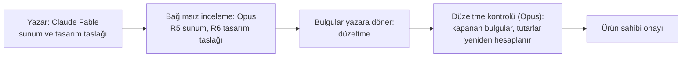

# Görüşme Paketi

Bu belge, pilot firmanın yöneticileriyle yapılacak keşif görüşmesi için hazırlanan paketin yapısını ve nasıl hazırlanıp denetlendiğini anlatır. Paket **ürün kodu değildir**: kapsamı taahhüt etmez, görüşmeyi somut bir zemine oturtmak için hazırlanmış bir tartışma malzemesidir. Paketin metinleri ve tasarım dosyaları pilot firmaya özel olduğu için bu depoda yayımlanmaz; burada yalnızca yapı ve süreç vardır.

> Belge numaraları, karar numaraları (K-xx, D-xx) ve "pilot keşif" kavramı için: [ARASTIRMA-OZETI.md](ARASTIRMA-OZETI.md#bu-belgeler-nasıl-okunur).

## İçindekiler

- [Ne içerir?](#ne-içerir)
- [Nasıl yapıldı?](#nasıl-yapıldı)
- [Yakalanan somut hatalar](#yakalanan-somut-hatalar)
- [Düzeltme kontrolü ve sonuç](#düzeltme-kontrolü-ve-sonuç)
- [Sınırlar](#sınırlar)
- [Ekran görüntüleri](#ekran-görüntüleri)

## Ne içerir?

| Parça | İçerik | Not |
|---|---|---|
| **Sunum** | Firma yöneticilerine yönelik 15 slayt: sorun, çözüm yaklaşımı, gelir ve gider akışı, ilk sürüm kapsamı, Excel dosyalarının paylaşımı; konuşmacı notlarıyla | Slayt ve tasarım kanvası olarak hazırlandı |
| **Tıklanabilir tasarım taslağı** | 5 ekran: sahip paneli, proje özeti, ara hakediş, gelen fatura onayı, Excel içe aktarma | Tüm kurum, firma ve tutarlar kurgusal ("Örnek …" adlı) |
| **Görüşme soru listesi** | Çıktısı alınabilen A4 soru listesi | Araştırma sonuçlarından türetilen soru listesinin baskı sürümü; içeriği pilot firmaya özel olduğundan yayımlanmaz |
| **Excel paylaşım rehberi** | Firmanın dosyalarını nasıl ve hangi bilgileri gizleyerek paylaşabileceğini anlatan kısa, çıktısı alınabilir rehber | Metni yayımlanmaz |

Tasarım ilkesi: proje merkezli gezinme, tek ana eylem, durumların yalnızca renkle değil yazıyla da anlatılması, Türkçe para ve tarih biçimi. Henüz kapsamda olmayan özelliklere (ör. banka bakiyesinin canlı gösterimi, otomatik e-Fatura çekme, teminat takibi) ekranda **"Sonraki aşama"** etiketi konmuştur; yanlarında ilk sürümde ne olacağını anlatan bir açıklama vardır (ör. "son aktarılan ekstreye göre", "XML dosyası elle yüklenir"). Kapsam taslaktır; özellikler görüşmeden sonra birlikte kesinleşir.

## Nasıl yapıldı?

- **Yazar ve inceleyen farklı modeldir:** tasarımı Claude Fable, incelemeyi Claude Opus yaptı; ikisi de Claude modelidir, bağımsızlık sınırlıdır. İnceleyiciler salt okunurdur; dosyayı değiştirmez, bulgu listesi verir; düzeltmeyi yazar yapar.
- İnceleme şu başlıklarda yapıldı: alan doğruluğu, söz verme riski, gizlilik ve kurgu, baskı belgeleri, kullanılabilirlik ve erişilebilirlik, teknik tutarlılık.
- Tasarım taslağındaki **tüm tutarlar yeniden hesaplandı**: kalem tutarları, grup toplamları, kesintiler, net tutar, panel toplamları ve oranlar tek tek kontrol edildi.
- Görsel kontrol için sunum slaytları 1920×1080 çözünürlükte ve en geniş yazı tipiyle (en kötü durum) ekran görüntüsüne alınarak taşma ve kontrast bakıldı.

## Yakalanan somut hatalar

İnceleme, aritmetiğin doğru olduğunu ama **alan mantığında** hatalar bulunduğunu gösterdi; bir firma sahibinin ilk bakışta fark edeceği türden hatalardı.

| Alan | Bulgu | Düzeltme |
|---|---|---|
| **Çifte teminat** | Hakediş ekranında kesin teminat her hakedişten ikinci kez kesiliyordu. Kamu yapım işinde kesin teminatın sözleşmeden önce bir kez verildiği varsayımıyla inceleme, kesin teminatın hakedişten yeniden kesilmesini hata olarak işaretledi; kuralın ayrıntısı ikincil kaynağa dayanır ve mevzuatla teyit edilecektir | Satır "fiyat farkı teminatı (fiyat farkı üzerinden)" olarak değişti; bağlı net tutarlar ve panel toplamları yeniden hesaplandı |
| **Eksik fiyat farkı satırı** | 2026 ilanlı bir işte fiyat farkı büyük olasılıkla hesaplanır; satırın olmaması "bunu bilmiyorlar" izlenimi verir. Harf düzeni de firmaların kullandığı hakediş raporundan farklıydı | Özet, yerleşik hakediş raporu sırasına göre (A–H, fiyat farkı satırı dahil) yeniden kuruldu. Bu düzen ikincil bilgidir; gerçek bir firma icmaliyle teyit edilecek |
| **Eksik kesintiler** | Avans, vergi ve SGK borcu mahsubu, gecikme cezası gibi kalemler yoktu | 0,00 ₺'lik satırlar olarak eklendi; net tutar değişmedi |
| **Belirsiz kuralın kesin gösterimi** | Hakedişte damga vergisi uygulaması araştırmada belirsiz bırakılmıştı | Satıra "örnek, teyit edilecek" notu konuldu |
| **Yanıltıcı "gecikme" senaryosu** | "Ödeme gecikti" kartı, kamuda tanınan onay ve ödeme sürelerini bilen biri için gecikme sayılmayacak bir durumu gösteriyordu | Kart "ödeme bekleniyor" olarak değişti |
| **Taslak hakedişin "gerçekleşen" sayılması** | "Gerçekleşen hakediş" taslak durumundaki hakedişi de kapsıyordu | Yalnız onaylılar sayıldı; ölçü "parasal ilerleme" olarak adlandırıldı |
| **Elektronik teminat** | İlan tarihine göre kesin teminat elektronik olmalıydı; mektup vadesi işin bitişinden önceydi | Tür e-teminat olarak, vade iş bitişinden sonra olacak biçimde düzeltildi |

Aynı inceleme, **müşteriye "söz verildi" izlenimi verebilecek ifadeleri** de yakaladı ve sunumda netleştirildi:

- Müşteriye söz verilmiş izlenimi verebilecek ifadeler netleştirildi (kapsamı ve sınırı belirtilmeden kesin taahhüt gibi duranlar); sunumun metni yayımlanmadığından tek tek alıntılanmaz.
- "Gelen e-Faturalar doğrudan sisteme alınıyor" otomatik çekme izlenimi veriyordu; ilk sürümde XML dosyası elle yüklenecek → ifade buna göre değişti.
- Bir alan etiketi ("Resmî kaynaktan doğrulandı") yalnız doğrulanan cümleye bağlanmadığı için gereğinden güçlüydü → etiket doğrulanan cümleye bağlandı.
- Henüz kapsamda olmayan özellikler "Sonraki aşama" diye işaretlendi.

## Düzeltme kontrolü ve sonuç

Düzeltmelerden sonra inceleyici her iki malzemeyi yeniden kontrol etti: sunumda tüm bulgular kapanmış, tasarım taslağında tüm yüksek ve orta önemli bulgular kapanmış ve tutarlar yeniden hesaplanıp doğrulanmıştı; ikisi de **görüşmede gösterilebilir** bulundu. Kalan düşük önemli notlar (ör. bazı hakediş dönemlerinin aylık olmaması, baskıda sayfa bölünmesi, kapak sayfasındaki yer tutucular) gösterimi engellemeyen küçük işlerdir. Birleştirme ürün sahibinin onayıyla yapılır; görüşmede kullanılıp kullanılmayacağı da ürün sahibinin kararıdır.

## Sınırlar

- Taslak ve sunum **pilot firmayla henüz gösterilmedi**; geri bildirim alınmadı.
- Hakediş özetinin harf düzeni ve damga vergisi gibi bazı kalemler ikincil bilgiye dayanır; gerçek bir firmanın hakediş dosyasıyla teyit edilecektir.
- Hukuk ve mali müşavirlik görüşü yerine geçmez; inceleyici de bir yapay zekâ agent'ıdır.
- Claude Fable, Opus ve Sonnet'in üçü de Claude modelidir; inceleme yazandan farklı bir modelle yapılır ama bağımsızlık sınırlıdır. Yazan ve inceleyen yine yapay zekâdır; ortak yanılgılar kaçmış olabilir.
- Tasarım taslağı bir ürün kodu değildir; arayüzün nihai hâli teknoloji ve kapsam kararlarından sonra belirlenir.

## Ekran görüntüleri

Ekran görüntüleri eklenecek ([docs/assets/](assets/) klasörüne). Şimdilik depoda görsel dosya yoktur. Eklenmeden önce ayrı bir sızıntı kontrolü yapılacak: görseller yalnızca kurgusal veri ve "Örnek …" adlarını içermeli.
